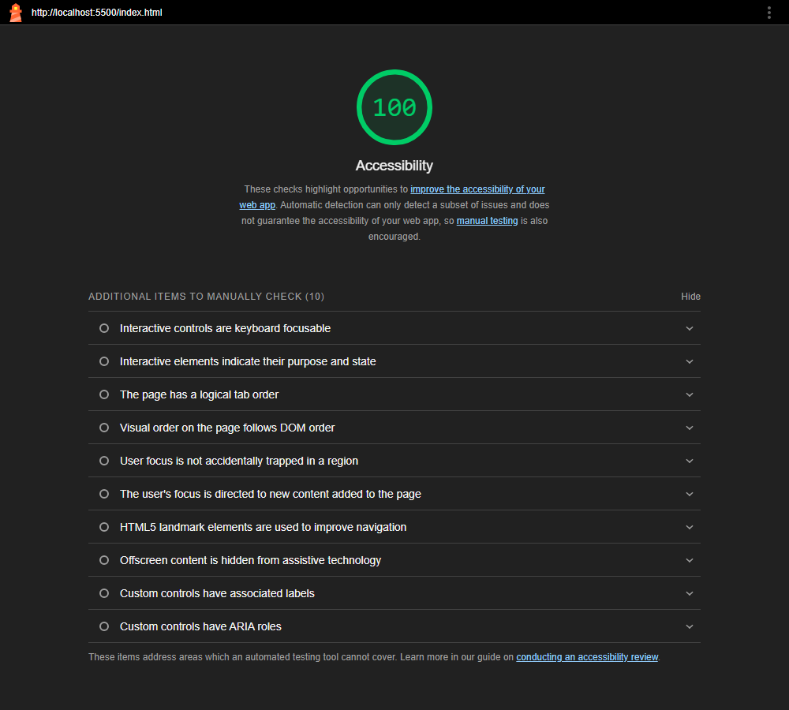

# MIS 457 – Week 2 Team Assignment: CampusLoop

**Project type:** Student club and event discovery (fictional sample prototype)

- Team name: Manifest
- Team members: Rüçhan Yılmaz, Abdullah Burak Özdemir, Ömer Çağan Öztürk, Çağrı Cebeci
- Course: MIS 457 – Web Based Application Programming
- Assignment: Week 2 – HTML5, Accessibility and Modern CSS
- Repository: https://github.com/Ruchan360/WebCourse-playground

## Project idea

CampusLoop is a static campus event discovery and sign-up prototype. It aims to help university students discover activities and connect with student clubs.

**Target users:** University students and student club organizers.

**Core features (planned):**
1. Browse upcoming club events.
2. Read event date, place and description.
3. Choose an event and preview a sign-up form.
4. Submit a browser-validated form in the static demo.
5. In future weeks, load event data with JavaScript, JSON and an API.

## Files

```
week2/
  index.html      Home page, six event cards, semantic sections
  join.html       Separate event sign-up form with labels and native validation
  thanks.html     Static demo confirmation; no registration created
  style.css       Mobile-first CSS, Flexbox header, Grid cards, accessibility
```

## How to run

Open the folder in VS Code, install the Live Server extension, and select **Go Live** on `week2/index.html`. The project can also be opened directly in a modern browser because Week 2 uses only HTML and CSS.

**Important:** This demo intentionally does not send or save personal information. The form fields have no `name` attributes, so submitting the demo via GET to `thanks.html` does not include their values in the URL. The browser still enforces `required`, `type="email"` and required selection.

## Instructor's Week 2 requirements and implementation

- [x] Static homepage (`index.html`)
- [x] One form page (`join.html`)
- [x] All inputs/selects/textarea have associated labels
- [x] Native required and email validation
- [x] Header uses Flexbox, brand to left and menu to right on desktop
- [x] Six event articles
- [x] Responsive CSS Grid: one column at 375px, three at 1280px
- [x] Semantic HTML (`header`, `nav`, `main`, `section`, `article`, `footer`)
- [x] Keyboard focus styles and skip-to-content link
- [x] HTML language and viewport tags
- [x] GitHub repository URL: https://github.com/Ruchan360/WebCourse-playground
- [x] Chrome Lighthouse Accessibility (Desktop): `index.html` **100**, `join.html` **100** — see [lighthouse/](lighthouse/)




## Get the Lighthouse screenshot (do not fake the score)

1. Use Google Chrome or Edge and open the homepage using Live Server.
2. Press F12, choose **Lighthouse**, tick **Accessibility** only and select **Desktop**.
3. Click **Analyze page load**.
4. Verify the actual score is **90 or more**. Fix any reported issues if necessary.
5. Capture the Lighthouse result on screen and include it with your submission.
6. Repeat the check on `join.html` if possible.

## GitHub submission

The instructor expects a shared team repository. To add the `week2` folder to the team repo, copy it into your repo root, then use:

```
git add week2
git commit -m "Build accessible Week 2 HTML CSS prototype"
git push
```

Submit the real repository URL and Lighthouse screenshot to the required LMS/course channel. Add the full names of all team members in the LMS description when only one teammate submits.

## Week 2 scope

No JavaScript, back-end API or actual data persistence is required for this week's static prototype. Those are later-week requirements.
